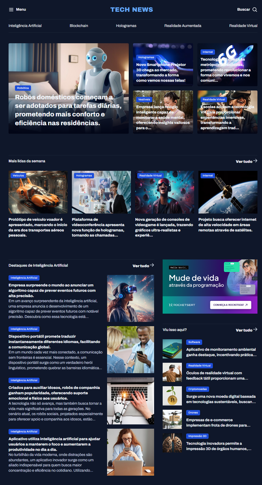

# Portal de Notícias

Projeto de estudo de HTML e CSS que reproduz o layout de um portal de notícias sobre tecnologia. O foco principal é praticar **CSS Grid** na organização das seções e dos cards da página.

## Prévia

## O que foi praticado

- Layouts com CSS Grid, incluindo colunas, fluxo e áreas nomeadas.
- Organização de notícias em destaques, matérias mais lidas e notícias sobre inteligência artificial.
- Estilização com CSS e imagens locais.

## Como visualizar

Abra o arquivo `index.html` em um navegador. O projeto não precisa de instalação de dependências.

## Tecnologias

- HTML5
- CSS3
